<div align="center">

</div>

```
I tinker around, build things and sometimes write about them!
based in  →  Ahmedabad, India
writing   →  yes, blogs. not a journal (mostly)
current   →  diving in AI agents + backend systems + devops
```

```
about me
├── i like building things end to end, from idea to deployed
├── i learn by breaking stuff, then writing about how i fixed it
└── always up for  →  good conversations about tech and side projects
```

<div align="center">
<sub><code>happy engineering!</code></sub>
</div>


